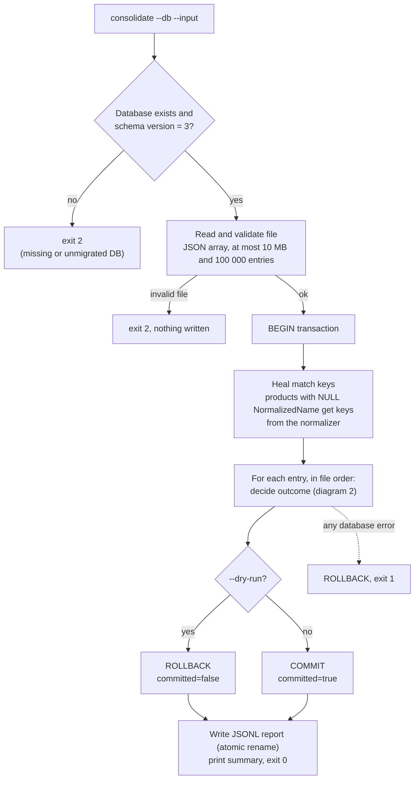
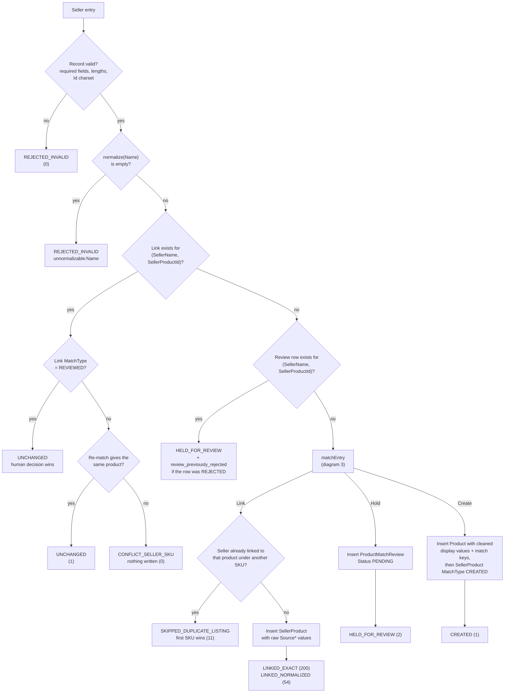
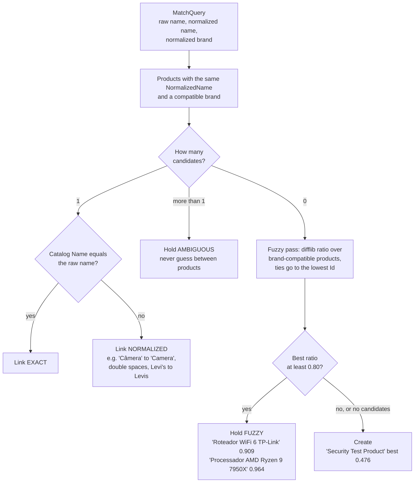
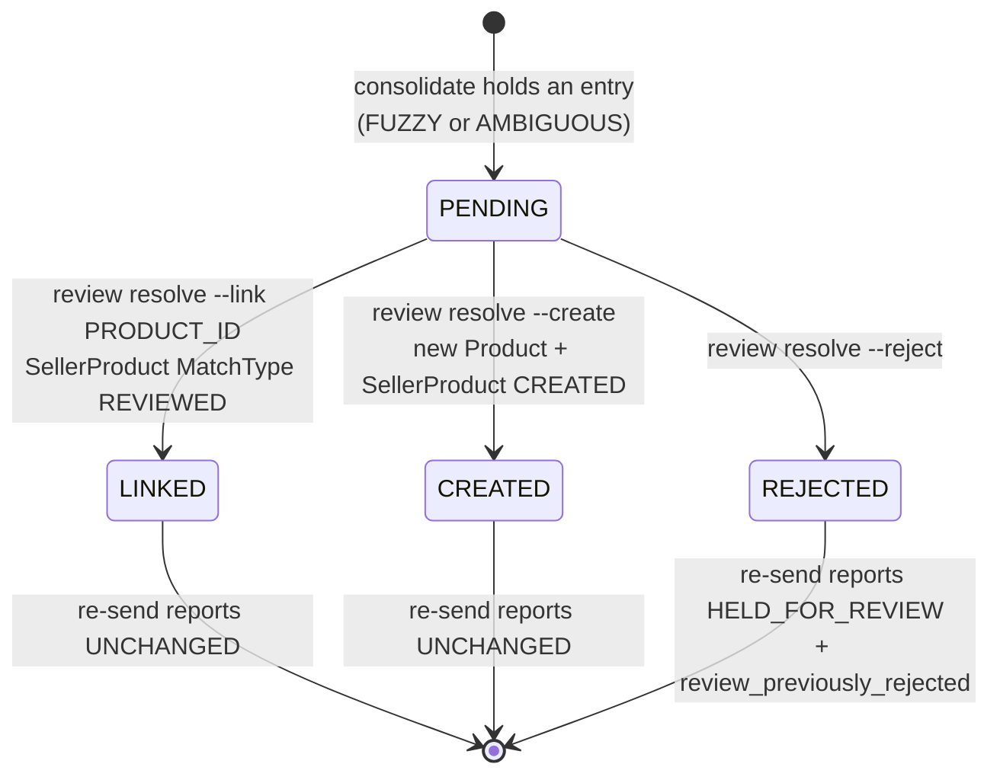

# Consolidation flow

How one run, and one seller entry inside it, moves through the system. Drawn from the code in
`libs/consolidation/src/consolidation-run.ts` and
`libs/rules/src/matching.service.ts`, not from the plan. Edge counts are the first run
on the provided `data/ProductEntry.json` (269 entries) against the migrated `data/catalog.db`.

Related: [PRD](../prds/0001-catalog-consolidation.md) ·
[ADR 0002 identity and matching](../adr/0002-product-identity-normalized-name-and-brand.md) ·
[ADR 0004 review queue](../adr/0004-review-queue-for-uncertain-matches.md) ·
[ADR 0005 run semantics](../adr/0005-all-or-nothing-idempotent-runs.md)

## 1. One run

A run is all-or-nothing: the file is read and validated before the transaction opens, and any
database error rolls back every write of the run.

Products created earlier in the same run are visible to later entries, because every entry is
processed inside the same transaction. Two sellers sending the same new product therefore give
one `CREATED` and one `LINKED_*`, not two products.

## 2. One entry

The catalog row is never overwritten by a seller. When a seller's spelling differs from the
catalog, the difference lives on that seller's `SellerProduct` row (`SourceName`, `SourceBrand`,
`SourceCategory`), so every offer can be traced back to what the seller sent.

## 3. Matching one entry

Identity is the normalized name plus a compatible brand. Category is not part of identity
(one seller says "Photo", the catalog says "Photography"). Two brands are compatible when they
are equal after normalization or when either is NULL (unknown is not different).

Fuzzy similarity only ever holds an entry for review; it never links. A false merge attaches a
seller's offer to the wrong product, which is harder to detect and undo than a duplicate, so the
system takes the cost of a delayed offer instead.

## 4. Review queue lifecycle

Only a `PENDING` row can be resolved; resolving any other row, linking to a missing product, or
linking a seller to a product it already offers exits 2 and writes nothing. A re-send while the
row is still `PENDING` reports `HELD_FOR_REVIEW` again without adding a second queue row.
